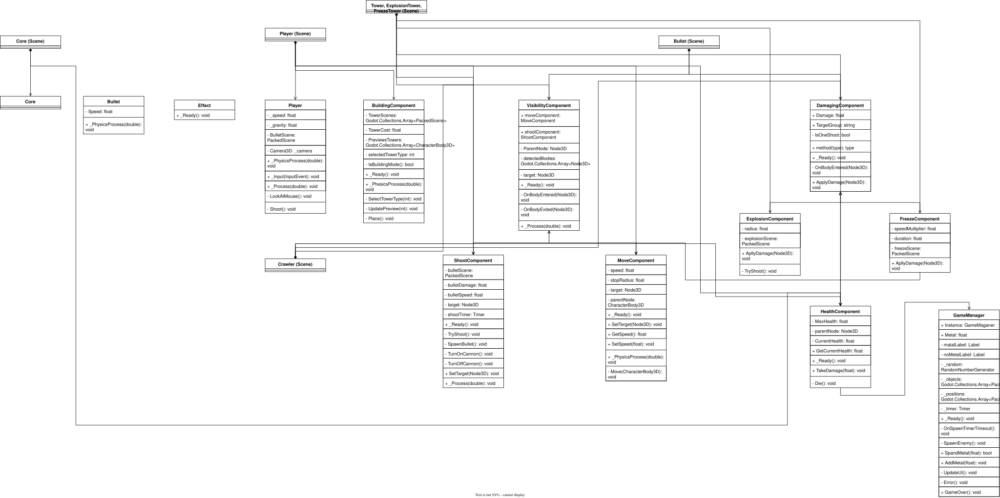

# Лабораторная работа №3. Прототип Tower-Defense.

## Управление 
- WASD - движение
- B - строительство 
- Enter - выполнить (чтобы уставить башню, нужно нажать Enter)
- 1, 2, 3 - типы башен (1 - обычная, 2 - башня с эффектом взрыва, 3 - башня с заморозкой)
- ЛКМ - стрельба
- ESC - выход из игры

## 1. Описание проекта

Проект представляет собой прототип игры в жанре Tower Defense. Для этого он может самостоятельно перемещаться по карте, атаковать противников и устанавливать башни с различными типами атак.
Основная особенность - использование конпонент вместо обычного наследования. Такой подход позволяет использовать одни и те же компоненты на разных объектах и комбинировать их для получения нового поведения.

## 2. Структура проекта

Основные игровые объекты представлены отдельными сценами. Компоненты добавляются к ним в качестве дочерних узлов.
Основные классы проекта:

- Player - игрок.
- Core - ядро, уничтожение которого приводит к завершению игры.
- GameManager - управление ресурсами и появлением врагов.
- Bullet - пуля.
- HealthComponent - отвечает за здоровье объекта и его уничтожение.
- MoveComponent - отвечает за перемещение объекта.
- ShootComponent - отвечает за стрельбу.
- VisibilityComponent - обнаруживает объекты в радиусе действия и выбирает цель.
- DamagingComponent - реализует общую логику нанесения урона.
- ExplosionComponent - реализует нанесение урона в области взрыва.
- FreezeComponent - наносит урон и временно замедляет противника.
- BuildingComponent - отвечает за выбор и установку башен.
- Effect - визуальный эффект, который автоматически удаляется через некоторое время.

## 3. Компоненты

### 3.1. HealthComponent

Отвечает за здоровье объекта. Он хранит максимальное и текущее количество здоровья.
Метод TakeDamage() уменьшает здоровье на переданное количество урона. Если здоровье становится меньше или равно нулю, вызывается метод Die().

При уничтожении объекта проверяется его тип:
- если объект принадлежит группе Enemy, игрок получает металл;
- если уничтожается Core, вызывается завершение игры;
- в остальных случаях родительский объект удаляется со сцены.

### 3.2. MoveComponent

Отвечает за перемещение объекта. В компоненте задаются скорость движения и расстояние, на котором объект должен остановиться.
В _PhysicsProcess() вызывается метод Move(), который рассчитывает направление от объекта к цели и изменяет его скорость. Если расстояние до цели больше заданного радиуса остановки, объект продолжает движение. В противном случае скорость устанавливается равной нулю.

### 3.3. ShootComponent

Отвечает за стрельбу игрового объекта. В нём задаются сцена снаряда и частота выстрелов. 
Метод SetTarget() получает объект, по которому необходимо стрелять. Если цель существует, компонент поворачивается в её направлении и включает стрельбу. При отсутствии цели стрельба останавливается, а оружие продолжает медленно поворачиваться.

### 3.4. VisibilityComponent

Отвечает за обнаружение объектов и выбор цели. Использует сигналы BodyEntered и BodyExited, чтобы отслеживать объекты.
При обнаружении объекта проверяется его группа. Объекты, принадлежащие к той же группе, что и родительский объект, игнорируются. Остальные объекты добавляются в список обнаруженных, если у них есть HealthComponent.
После этого компонент находит ближайшую цель и передаёт её компонентам ShootComponent и MoveComponent.

## 4. Система нанесения урона

### 4.1. DamagingComponent

Базовая компонента для всех объектов, которые могут наносить урон.
Содержит:
- количество наносимого урона;
- группу объектов, которым можно нанести урон;
- параметр, определяющий, должен ли компонент удаляться после срабатывания.

При столкновении с другим объектом вызывается OnBodyEntered(). Если объект принадлежит к указанной для цели группе, вызывается метод ApplyDamage().
Метод находит у цели HealthComponent и передаёт ему значение урона. Если эффект одноразовый, родительский объект удаляется со сцены.

### 4.2. ExplosionComponent

Наследуется от DamagingComponent.
При срабатывании компонент изменяет радиус своего CollisionShape3D, после чего через проверяет объекты, находящиеся внутри области поражения.
Все подходящие цели получают урон. 

### 4.3. FreezeComponent

FreezeComponent наследуется от DamagingComponent.
При попадании сначала наносится урон, после чего компонент ищет у цели MoveComponent. Если он найден, текущая скорость сохраняется, а новая скорость рассчитывается с помощью коэффициента замедления.
Через заданное время скорость возвращается к исходному значению.

## 5. Установка башен

За установку башен отвечает BuildingComponent. Компонента хранит список сцен башен, список предварительного просмотра и выбранный тип башни.
При нажатии клавиши строительства включается или выключается режим установки. Для этого используются отдельные клавиши.
После выбора типа вызывается UpdatePreview(), который показывает объект предварительного просмотра.
При подтверждении установки вызывается Place(). Сначала проверяется, достаточно ли у игрока металла для покупки башни. Если ресурсов достаточно - башня устанавливается. После этого режим строительства выключается.

## 6. Игрок и ядро базы

### 6.1. Player

Player - управляет игрок.
Игрок поворачивается в след за мышью, делает выстрелы. Также реализована возможность выхода из игры по назначенной клавише.

### 6.2. Core

Core представляет собой ядро. Оно является отдельным игровым объектом и использует HealthComponent для хранения и изменения здоровья.
Ядро не перемещается и не атакует противников. При его уничтожении игровая сцена перезагружается.

## 7. Управление игрой и система ресурсов

### 7.1. GameManager

Отвечает за общие процессы игры. Для доступа к нему из других компонентов используется статическое свойство Instance.

Основные задачи:
- хранение текущего количества металла;
- начисление и списание ресурсов;
- обновление интерфейса;
- появление врагов;
- завершение игры.

В этом классе реализован спавн врагов (через равные промежутки времени в одном из 3-х выбранных мест на поле).
Метод SpendMetal() проверяет, достаточно ли ресурсов для установки башни. Если металла хватает, необходимое количество списывается. Если ресурсов недостаточно, вызывается Error(), который показывает соответствующее сообщение на экране.
Метод AddMetal() увеличивает количество ресурсов. После изменения металла интерфейс обновляется с помощью UpdateUI().

### 7.2. Система металла

Металл используется для установки башен. Начальное количество ресурсов задаётся в GameManager.
При уничтожении противника HealthComponent проверяет его группу и передаёт GameManager команду на начисление металла.
При попытке установить башню сначала проверяется наличие необходимого количества ресурсов. 

## 8. Дополнительные классы

### 8.1. Bullet

Bullet представляет собой снаряд, который перемещается вперёд по направлению своей локальной оси -Z.
Скорость снаряда задаётся через экспортируемое поле Speed. Перемещение выполняется в _PhysicsProcess().
Логика нанесения урона при этом находится не в самом классе пули, а в отдельном DamagingComponent.

### 8.2. Effect

Effect отвечает визуальный эффект. После создания запускается таймер, по истечении которого объект удаляется со сцены.

## UML-диаграмма
